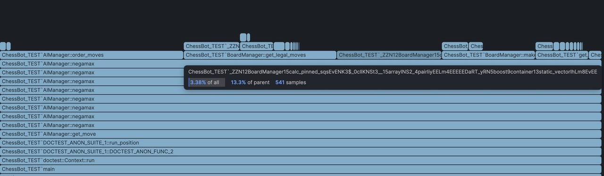

A C++23 chess engine with an accompanying GUI. The goal of this project is to develop a strong, fast engine using established techniques, and rigorously measure its performance.  


## Features
- **Bitboards** for compact and fast board state representation
- **Magic Bitboards** shifts runtime move generation work to program startup using precomputed tables
- **Negamax alpha-beta search** (core search functionality)
- **Iterative deepening** enabling deeper search depths in end-game scenarios, and enforcing engine decisions within a timeframe
- **Transposition Tables** enabling 'memory' of previously seen positions from different branches in the search tree
- **Move Ordering** to explore the expected best moves first, thereby reducing the alpha-beta search tree greatly
- **Testing and Benchmarking** using [doctest](https://github.com/doctest/doctest): [PERFT](https://chessprogramming.org/Perft) suites, 300-position tactical suite ([Win At Chess](https://chessprogramming.org/Win_at_Chess)), and iterative performance benchmarking tracking

## Installation
**Requirements**
- A C++23 compiler (or later)
- [CMake](https://cmake.org/) 3.21 (or later)

All other dependencies are managed via [vcpkg](https://vcpkg.io/en/) and are automatically installed.


**Build from source**
```
git clone https://github.com/barrett-daniel/chess-bot
cd chess-bot
git submodule update --init --recursive
mkdir build
cd build
cmake ..
cmake --build . --config Release --target ChessBot
```

This produces the `ChessBot` executable in the `build/Release` directory.

## Usage
To run the chess bot:
```
./Release/ChessBot
```

You can use the GUI to make moves by clicking on a piece. When a piece is selected, it will show what moves it is allowed to make, denoted by the grey circle in the destination squares. You can de-select a piece with right-click.

## Engine Design

```
                                        ┌──────────────────────────────┐
                                        │ UI (SDL3)                    │
                                        │ - input handling             │
                                        │ - rendering                  │
                                        └───────┬─────────────┬────────┘
                                                │ user moves  │ board state
                                                ▼             ▲
┌──────────────────────────┐            ┌───────┴─────────────┴────────┐
│ AI                       │ board state│ Board Manager                │
│ - Search                 │◄───────────│ - board state tracking       │
│ - Transposition table    │ best move  │   and manipulation           │
│ - Move ordering          │───────────►│                              │
└──────────────────────────┘            └───────┬─────────────┬────────┘
                                                │ fetch moves │
                                                ▼             ▲
                                        ┌───────┴─────────────┴────────┐
                                        │ Move Generation              │
                                        │ - bit computation for moves  │
                                        │ - magic bitboards            │
                                        └──────────────────────────────┘
```

### Board Representation and Move Generation
- Twelve piece bitboards plus aggregate occupancy boards. Each bitboard is a 64-bit number where each bit indicates whether a piece is present at the associated square. This allows much more compact board state representation, and enables the use of fast bitwise operations.
- Stack-based `undo_move`
- Sliding-piece moves are precomputed using [**Magic Bitboards**](https://chessprogramming.org/Magic_Bitboards) drastically reducing overall performance overhead associated with runtime computation of these pieces.
- All other piece move generation is handled using bit-shifts and masks on bitboards for simultaneous computation of moves by like-pieces.
- Two-tier move legality filtering: all possible moves are generated, then filtered based on legality. Move legality is verified using deterministic rules for easily computable legal moves; more complex move patterns which may expose the king to check are delegated to running full compute of the subsequent board state and then verifying check.
- Release builds use the `boost::container::static_vector` (stack-allocated, fixed max-size vector) for possible move lists leveraging the fact the max number of moves from any given position is [218]( https://lichess.org/@/Tobs40/blog/why-a-reachable-position-can-have-at-most-218-playable-moves/a5xdxeqs). Debug builds use `std::vector` for easier stack-trace debugging.

### Search

| Technique | Notes |
|-----------|-------|
| Negamax with alpha-beta pruning | Core search, mate scores adjusted by depth |
| [Iterative deepening](https://chessprogramming.org/Iterative_Deepening) | Searches depth 1, 2, 3, … until the time budget expires |
| Time control | Clock checked every 2048 nodes; an aborted iteration unwinds immediately and the engine falls back to the best move from the last fully completed depth |
| [Transposition table](https://chessprogramming.org/Transposition_Table) | 4 MB, indexed by `hash & mask`; stores exact / lower-bound / upper-bound entries with a best move. Depth-preferred replacement |
| Move ordering | Moves are sorted based on expected quality to maximise tree-branch pruning with alpha-beta. Transposition Table best move -> captures by Most Valuable Victim Least Valuable Attacker (MVV-LVA) -> two [killer moves](https://chessprogramming.org/Killer_Move) per depth -> history heuristic based on previously seen good moves (decayed over time) |
| Draw detection in search | 50-move rule, 3-fold repetition and insufficient material are scored as draws inside the tree |
| Static Board Evaluation | Using incremental updates to reduce runtime overhead of evaluating a position. Uses piece-square tables to score pieces based on their respective board position, with score interpolation between 'ideal' middlegame and endgame positions for each piece |

## Evaluation and Testing

| Technique | Notes |
|-----------|-------|
| PERFT | Used to validate if chess is modelled accurately. The number of possible moves at increasing search tree depths is known for certain positions. By counting the number of possible states generated by this model, and comparing it to the known standard, we can validate the correctness of the chess model |
| Win At Chess | A 300-position test suite with known optimal moves. The engine can be run against the suite to validate if it finds the optimal move in a given scenario. This helps validate the engine's ability to identify winning moves, checkmates, or obviously correct moves |
| Performance Benchmarking | Across development iterations, metrics such as max depth reached and nodes per second are recorded to verify relative performance improvements between engine versions |
| Other Tests | Various other tests are included, e.g. to validate that draw states are identified, and that the incremental Zobrist hashing and board evaluation scores are equivalent to the slower static evaluation of such algorithms |

To run the tests (from project root):
```
cmake --build build --config Release --target ChessBot_TEST
./build/Release/ChessBot_TEST
```

Note that some tests will take a long time to run on commodity hardware. You can choose to run specific test suites with the `-ts` flag, exclude a test suite with `-tse`, or list the suites with `-lts`. For example:
```
$ ./Release/ChessBot_TEST -lts
[doctest] listing all test suites
===============================================================================
50 Move Rule
3-Fold Repetition
Stalemate
Insufficient Material
Magic Tests
Incremental Hash Tests
Incremental Board Evaluation Tests
PERFT Tests
Speed Tests
Win At Chess

$ ./build/Release/ChessBot_TEST -ts="50 Move Rule"
[doctest] doctest version is "2.5.3"
[doctest] run with "--help" for options
===============================================================================
[doctest] test cases: 2 | 2 passed | 0 failed | 34 skipped
[doctest] assertions: 2 | 2 passed | 0 failed |
[doctest] Status: SUCCESS!
```

More info on Doctest's command line arguments can be found [here](https://github.com/doctest/doctest/blob/master/doc/markdown/commandline.md).

## Future Developments
Planned future work in priority order:
- [ ] UCI protocol support for use with external GUIs and engine-vs-engine matches
- [ ] Elo estimation by playing the bot against existing chess bot's with established elos
- [ ] Opening book moves and endgame position database look-ups
- [ ] GUI for run configurations, e.g. play as white/black, FEN string input starting position, etc.
- [ ] Improving Win At Chess position evaluation. Currently, there is no distinguishing between the model making a bad move, and a good move which is just not the optimal move - both fail (even if the good move is approximately equivalent to the optimal one)
- [ ] Optimisation of hot path. By analysing the flamegraph for the engine (example below), shows that calculating which pieces are pinned (and therefore can't move unless its in the direction of the pin) costs a significant relative performance overhead. This could be optimised using precomputed pin-tables, similar in principle to the magic bitboards already used.




## Credits
- Piece and board artwork by **JohnPablok** — [OpenGameArt](https://opengameart.org/content/chess-pieces-and-board-squares), licensed CC BY-SA 3.0
- PERFT reference positions and node counts from the [Chess Programming Wiki](https://www.chessprogramming.org/Perft_Results)
- *Win At Chess* positions based on the book by Fred Reinfeld (1958), [EPD data](/test/resources/wac_database.txt) from [Chess Programming](https://chessprogramming.org/Win_at_Chess)
- Built with [SDL3](https://www.libsdl.org/), [Boost.Container](https://www.boost.org/doc/libs/release/doc/html/container.html), and [doctest](https://github.com/doctest/doctest)